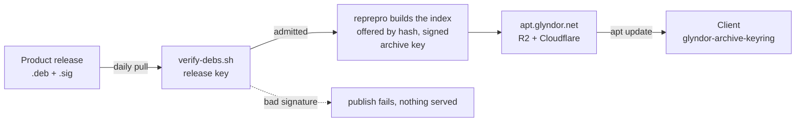

# Glyndor apt repository

Signed `.deb` packages for Glyndor software on Debian and Ubuntu, for `amd64` and `arm64`.

[](https://github.com/Glyndor/apt/actions/workflows/health-check.yml)
[](https://github.com/Glyndor/apt/actions/workflows/publish.yml)

## Install

```bash
curl -fsSL https://apt.glyndor.net/install/podup | sudo sh
```

The script needs `curl` and `ca-certificates`. A minimal image, a container for
example, has neither and has no `sudo` either. There you are already root, so
install the two and run the command above without `sudo`:

```bash
apt-get update && apt-get install -y ca-certificates curl
```

The script:

- adds the Glyndor archive and installs its signing key after checking the
  fingerprint against the one published [below](#verify-the-signing-key);
- installs the package and what it depends on, including a current Podman;
- reports whether the daily Glyndor upgrade timer is on (it installs the
  `unattended-upgrades` package if it is missing, and the keyring package adds
  `Glyndor:stable` to that tool's allowed origins; its schedule is not changed).

If one of its checks fails before the keyring is installed, it exits without
running anything from the download. An error after that point comes from `dpkg`
or `apt-get`.

To install `epistle` or `podman` the same way, replace `podup` with its name.
Only those three have an installer: `glyndor-archive-keyring` in the next table is
installed by the script, and any other name gets a 404 that `curl -f` reports but
that does not make the pipe exit non-zero, so read what it prints. After installing podup, go on with its
[quick start](https://github.com/Glyndor/podup#quick-start).

## What is served

| Package | What it is |
| --- | --- |
| [`podup`](https://github.com/Glyndor/podup) | Run Compose projects on rootless Podman. |
| [`podman`](https://github.com/Glyndor/podman) | Signed Podman packages for Debian 13 and Ubuntu 24.04 and 26.04, built from the latest stable upstream releases. |
| [`epistle`](https://github.com/Glyndor/epistle) | A self-hosted mail server for your own domains. |
| `glyndor-archive-keyring` | The archive signing key and apt source, installed by the script. |

podup needs Podman 6.2.0 or newer and does not support Podman 5. The `podman`
package here is that Podman, so on the releases listed under Supported releases
installing podup pulls it in, whatever Podman the distribution ships. epistle runs its mail
stack through podup.

```bash
apt list '?origin(Glyndor)'   # everything currently served
```

The same software is also available through a
[Homebrew tap](https://github.com/Glyndor/homebrew-tap) for macOS and Linux and a
[Scoop bucket](https://github.com/Glyndor/scoop-bucket) for Windows, which carry
podup only. Fedora, RHEL and openSUSE are served from the
[rpm repository](https://github.com/Glyndor/rpm), and Arch Linux from the
[pacman repository](https://github.com/Glyndor/pacman).

## Supported releases

The floor is glibc 2.39. This archive serves its own Podman, built to run on
glibc 2.39 or newer, so it installs on the Debian and Ubuntu releases that have
it and refuses on the older ones rather than installing a Podman that does not
start. The refusal names the library:
`libc6 (>= 2.39) but 2.35-0ubuntu3.15 is to be installed`.

The [distribution floor workflow](.github/workflows/distro-floor.yml) runs the
install line above, for each of the three products the archive serves (`podup`,
`epistle` and `podman`), in fresh containers every week and after each
publication, and asserts exactly this:

| Image | Expected |
| --- | --- |
| `debian:trixie` | installs |
| `ubuntu:24.04` | installs |
| `ubuntu:26.04` | installs |
| `ubuntu:22.04` | refused, naming libc6 |
| `debian:12` | refused, naming libc6 |

A release missing from that table has not been measured.

The same workflow also tries the upgrade. On each release that installs, it puts
in place the version of each product before the served one, runs
`apt-get install --only-upgrade`, and checks that the served version is now
installed, that the product starts, and that dpkg is left with nothing half
configured. The archive keeps the latest version only, so the version before is
the one of the product's previous release; a product with no earlier release
fails that check instead of passing it.

## Automatic upgrades

The signing key ships as a package, so apt keeps it current. The same package
installs `glyndor-upgrade.timer`, which runs daily and upgrades the packages from
this archive, and leaves every other package alone. It does not change the
machine's own `unattended-upgrades` schedule. It does install
`/etc/apt/apt.conf.d/51glyndor-unattended-upgrades`, which adds `Glyndor:stable` to the
origins that tool may upgrade from, and it needs systemd.

To opt out, run `sudo systemctl disable --now glyndor-upgrade.timer`. That choice
survives upgrades of the package.

## Verify the signing key

This is the **archive** key, the one apt uses to check the index. The
installer compares it for you; repeat it by hand to confirm a key already
installed, or if you would rather not pipe a network response into a shell.

```bash
curl -fsSLO --proto '=https' --proto-redir '=https' --max-filesize 8388608 https://apt.glyndor.net/glyndor-archive-keyring.deb
curl -fsSLO --proto '=https' --proto-redir '=https' --max-filesize 65536 https://apt.glyndor.net/glyndor-archive-keyring.deb.asc
dpkg-deb --fsys-tarfile glyndor-archive-keyring.deb | tar -t -v --numeric-owner |
  awk '$3 !~ /^[0-9]+$/ { bad = 1 } { total += $3 } END { exit (bad || total > 8 * 1024 * 1024) }'
dpkg-deb -x glyndor-archive-keyring.deb keyring-check
gpg --show-keys --fingerprint keyring-check/usr/share/keyrings/glyndor.gpg
```

Nothing from the package runs. The downloads are capped at 8 MiB and 64 KiB, and the
`awk` line refuses a package whose files declare more than 8 MiB once unpacked (a
sparse member costs a few kilobytes in the archive and 16 MiB on disk). Those are two of
the three bounds the installer applies; the third caps the unpacked archive itself at
8 MiB before it is extracted. If the line exits non-zero, stop and report it. The fingerprint it prints must be **exactly**:

```
9ADF 04EA 8C31 39CD B673  03CF A670 5C2E A153 F3D6
```

Published here, not on `apt.glyndor.net`. A tampered archive cannot vouch for
itself. Same value for a copy already installed, at
`/usr/share/keyrings/glyndor.gpg`.

> [!CAUTION]
> `dpkg -i` runs maintainer scripts as root. If it does not match, delete the
> download and report it via the **Security** tab. `dpkg -r` does not undo
> what a maintainer script already did.

The fingerprint authenticates the key, not the package that carried it: a
substituted `.deb` can ship the genuine key next to a hostile maintainer
script. So also check the detached signature over the whole package with that
key, which must exit 0 (the keyring path has to be absolute):

```bash
GNUPGHOME="$(mktemp -d)" gpg --no-default-keyring \
  --keyring "$PWD/keyring-check/usr/share/keyrings/glyndor.gpg" \
  --verify glyndor-archive-keyring.deb.asc glyndor-archive-keyring.deb
```

Only once both pass:

```bash
sudo dpkg -i glyndor-archive-keyring.deb
```

> [!WARNING]
> Do not stop here and install the package with apt. The keyring switches the
> upgrade timer on, but the timer runs the `unattended-upgrades` engine, and
> only the script installs that when it is missing. Run the install command at
> the top instead.

## How it works



Two keys do two jobs. The *release* key proves a package is the one its product
published, and this repository checks it. The *archive* key proves the index is
the one this repository built, and you check it above. The archive is rebuilt
from scratch on every run, so the failure mode is an archive that does not
update, never one that serves something unverified.

A second, post-quantum release signature (ML-DSA-65) can sit beside the
Ed25519 one and never replaces it. No ML-DSA-65 key is configured yet, so every
package is admitted on its Ed25519 signature, and a package that carries a second
signature is refused at publication, because the archive cannot check it. It is
checked when a package is admitted; apt on a client verifies the archive's index
with Ed25519 only.

The [threat model](docs/threat-model.md) covers these controls and the others, with the test
that holds each one in place.

---

See [CONTRIBUTING.md](CONTRIBUTING.md). Report a problem via the
[Security](https://github.com/Glyndor/apt/security) tab.

[MIT](LICENSE).
